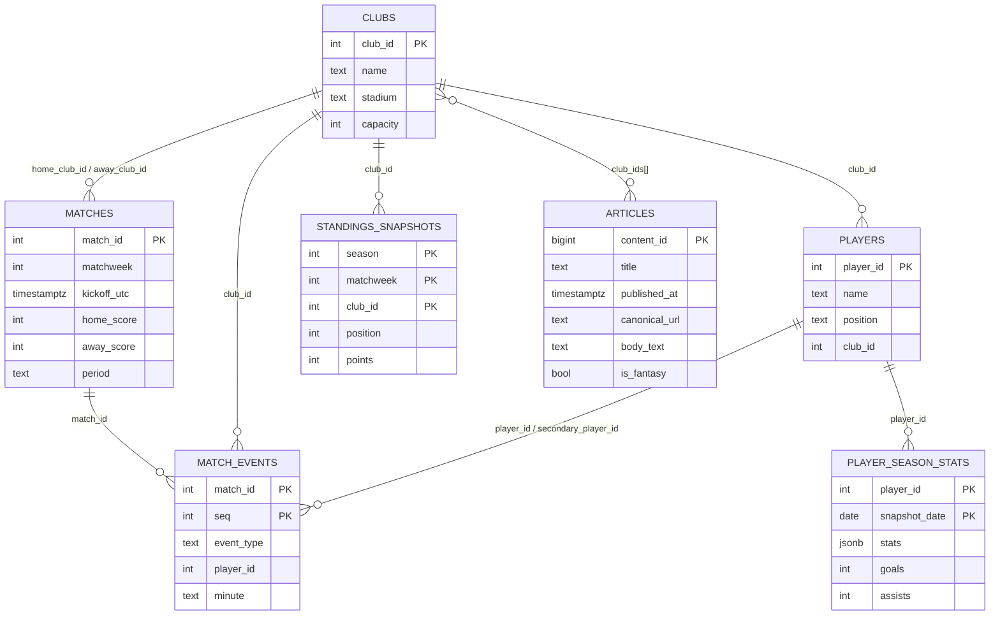

# Architecture

## System overview

A local system: Postgres 16 with pgvector holds all data, a Python backend runs ingestion, retrieval and the chat loop against Azure OpenAI (Microsoft Foundry), and a React UI talks to the backend. Scope is the current season only (2026-27, season id 2026).

## Data sources

The unauthenticated JSON APIs that www.premierleague.com calls itself: the Content API for articles and the SDP football API for structured data, with the FPL API as fallback. Details and field lists: [docs/data_sources.md](docs/data_sources.md), decision: [ADR 0003](docs/adr/0003-data-sources.md).

## Ingestion (bronze/silver/gold)

All HTTP goes through one polite client (`ingestion/pl_client.py`: project User-Agent, 0.5 s delay, backoff on 429/5xx). Every response it receives is written to bronze first; silver is then built **only from bronze**, never from the live response.

```
PLClient --on_response--> bronze.api_responses --load_from_bronze--> silver.* --views--> gold.*
                          (append-only, raw JSON)  (dispatch by endpoint)  (typed, upserted)  (tool queries)
```

- **bronze**: `bronze.api_responses`: one row per HTTP response (source, endpoint, params, payload, fetched_at, sha256). A trigger rejects UPDATE and DELETE.
- **silver**: typed rows upserted by natural key: clubs, players, matches, match_events, standings_snapshots, player_season_stats, articles. Re-running any mode, or replaying all of bronze (`python -m ingestion rebuild`), gives the same rows.
- **gold**: views and SQL functions the Phase 2 tools will query: `league_table_current`, `top_scorers`, `top_assists`, `club_form_last5`, `matchweek_results(mw)`, `head_to_head(a, b)`, `table_moves`. Embedded article chunks for RAG are added to gold in Phase 2.

Only `backend/db.py` owns DDL (`init_db()` is idempotent and runs at the start of every CLI mode). `db/init.sql` only creates the extension and schemas on a fresh volume. Tables, keys and columns: [docs/ingestion_schema.md](docs/ingestion_schema.md).



### CLI modes

| Mode | Fetches | Articles |
|---|---|---|
| `backfill --season 2026` | clubs, squads, all matches, events of every finished match, standings, leaderboards | since `--since` (default 2026-08-01) |
| `matchweek` | the same, but events only for the latest finished matchweek and any finished match still without events | since the newest stored article minus one day |
| `news` | nothing from SDP | since the newest stored article minus one day |
| `rebuild` | nothing; replays all of bronze into silver | |

After every mode `ingestion/quality.py` runs and the command exits non-zero if a check fails: 20 clubs, 380 matches, points = 3W + D, played = W + D + L, every finished match has a score, no duplicate article ids. `news` runs the article checks only.

Two API quirks shape silver. First, the standings endpoint only returns the current table, so `standings_snapshots` gets one snapshot per matchweek run, and `table_moves` has data from the second weekly run onward. Second, the leaderboard omits zero values and each sort returns a different subset of players, so the client fetches four sorts and silver merges them into one `stats` jsonb per player per day.

### Scheduling

The database is local-only, so the real scheduled runs happen on Eli's laptop through Windows Task Scheduler. `scripts/schedule_windows.ps1` registers them: `matchweek` on Monday 23:30 UTC (Tuesday 00:30 Brussels in winter) and `news` on Thursday 23:00 UTC (Friday 00:00 Brussels in winter). During summer time they fire an hour earlier in UTC; the script explains this. GitHub Actions runs the same two modes on the same cron times (`ingest-matchweek.yml`, `ingest-news.yml`) against a throwaway Postgres. That is a smoke test that the live sources still work and still match our parsers, and it uploads the JSON summary as an artifact.

## Why tool calling for stats and RAG for news

Numbers must be exact and current, so they come from SQL-backed tools; articles are prose, so they are retrieved. The model never states a number it did not get from a tool. See [ADR 0001](docs/adr/0001-tool-calling-for-stats-rag-for-news.md).

## RAG pipeline

Articles are cleaned (script/style removed, tags stripped), chunked, embedded and stored in pgvector, filtered by date and club references. Retrieved text passes Prompt Shields before reaching the model; answers cite title, date and URL. *Chunking, embedding model and ranking: Phase 2.*

## Chat loop

*Phase 2.* Decline betting advice and off-topic questions.

## Weekly digests

Generated from stored data only, with citations and fixed config-driven ranking weights, published to GitHub Pages:

- Monday 23:30 UTC ingest, Tuesday 05:00 UTC matchweek recap.
- Thursday 23:00 UTC ingest, Friday 05:00 UTC news highlights.

*Details: Phase 5.*

## MCP server

An own Premier League MCP server (FastMCP) exposing the same tools. See [ADR 0004](docs/adr/0004-own-mcp-server.md). *Phase 5.*

## Evaluation

An eval dataset and runner; changes to llm, rag, prompts, evals or mcp_server must pass it, and thresholds are never lowered to get green. *Phase 3.*

## AI Ops

Self-hosted Langfuse tracing ([ADR 0005](docs/adr/0005-langfuse-for-tracing.md)), a CI eval gate, a cost and latency dashboard and a feedback loop. *Phase 6.*

## Frontend

React UI over the backend API. *Phase 4.*

## Trade-offs

- One Postgres for relational data and vectors instead of a separate vector DB ([ADR 0002](docs/adr/0002-single-postgres-store.md)).
- Undocumented APIs: cheap and complete, but may change without notice; mitigated by keeping raw bronze and schema checks.
- Current season only keeps data small and answers unambiguous.
