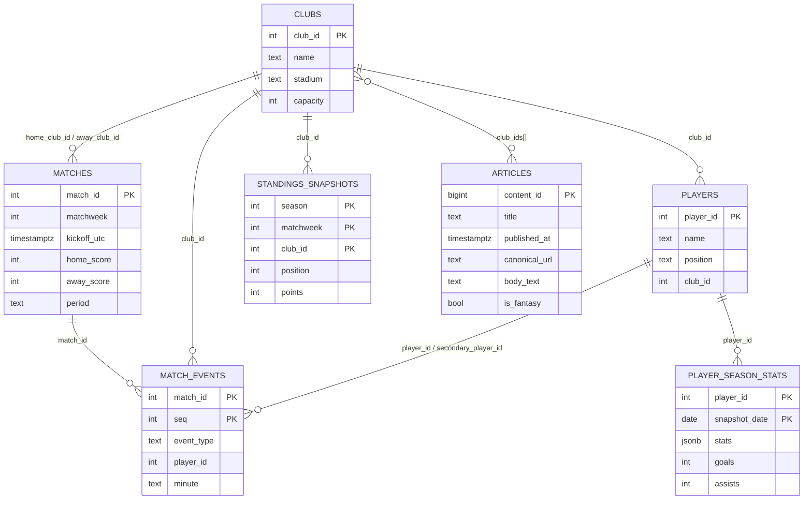

# Architecture

## System overview

A local system: Postgres 16 with pgvector holds all data, a Python backend runs ingestion, retrieval and the chat loop against Azure OpenAI (Microsoft Foundry), and a React UI talks to the backend. Scope is the current season only (2026-27, season id 2026).

## Decisions

Every choice that shapes the project, with where it is argued in full. ADRs live in [docs/adr/](docs/adr/).

| Decision | Why, in one line | Where |
|---|---|---|
| Stats through tool calls, news through RAG | numbers must be exact and current; articles are prose | [ADR 0001](docs/adr/0001-tool-calling-for-stats-rag-for-news.md) |
| One Postgres (with pgvector) for data and vectors | one store to run, back up and join across | [ADR 0002](docs/adr/0002-single-postgres-store.md) |
| The public JSON feeds premierleague.com uses itself | complete, current and free; raw bronze guards against changes | [ADR 0003](docs/adr/0003-data-sources.md) |
| Bronze (raw, append-only) → silver (typed) → gold (views) | any bug in parsing can be fixed by replaying bronze, without refetching | [Ingestion](#ingestion-bronzesilvergold) |
| One polite HTTP client with a delay and backoff | the feeds are someone else's servers | [Ingestion](#ingestion-bronzesilvergold) |
| Current season only | small data, unambiguous answers | [Trade-offs](#trade-offs) |
| Local-first; Azure OpenAI via Foundry (`gpt-5.4-mini`, `text-embedding-3-small`) | the budget goes to model calls, not hosting | [ADR 0012](docs/adr/0012-local-first-on-azure-openai.md) |
| Hybrid retrieval (vector + full text, RRF) with a recency weight | names and "matchweek 8" need exact matching; news goes stale | [ADR 0006](docs/adr/0006-hybrid-retrieval.md) |
| Prompt Shields on every retrieved chunk, failing closed | articles are the main injection path into the prompt | [RAG pipeline](#rag-pipeline) |
| Versioned prompt files, version stored on every model call | a behaviour change is reviewable and comparable in evals | [Chat loop](#chat-loop) |
| Citation markers resolved by code, not URLs written by the model | the model cannot invent a link | [ADR 0008](docs/adr/0008-structured-citations.md) |
| Evals with SQL goldens, code checks first, judges only where needed | goldens stay correct as the season moves; judges are biased | [ADR 0007](docs/adr/0007-eval-design.md) |
| Thresholds from a measured run minus one case, never lowered | a real regression fails, one flaky case does not | [Evaluation](#evaluation) |
| Weekly summaries: facts gathered by code, prose by the model, every line validated | a summary can't state a score that didn't happen | [ADR 0009](docs/adr/0009-digests-on-github-pages.md) |
| Summary ranking with fixed weights in a config file | the same week always ranks the same way | [Weekly digests](#weekly-digests) |
| Own MCP server serving the exact chat tool schemas | one tool layer for the app, Claude and VS Code | [ADR 0004](docs/adr/0004-own-mcp-server.md) |
| The chat itself is an MCP client (in-process by default) | the evals measure what other MCP clients get too | [ADR 0010](docs/adr/0010-chat-as-mcp-client.md) |
| Self-hosted Langfuse for traces; only totals published | traces hold questions and answers, which stay local | [ADR 0005](docs/adr/0005-langfuse-for-tracing.md), [ADR 0011](docs/adr/0011-ai-ops.md) |
| Eval gate on GitHub runs the full set, started by hand only | the smoke subset was too small; every run costs about $0.90 | [ADR 0011](docs/adr/0011-ai-ops.md) |
| No betting advice; off-topic questions declined | scope and responsibility | [Chat loop](#chat-loop) |
| Secrets only in `.env`, never in code, compose files or commits | the repository is public | [README](README.md#step-4-fill-in-your-settings) |

## Data sources

The unauthenticated JSON APIs that www.premierleague.com calls itself: the Content API for articles and the SDP football API for structured data, with the FPL API as fallback. Details and field lists: [docs/data_sources.md](docs/data_sources.md), decision: [ADR 0003](docs/adr/0003-data-sources.md).

## Ingestion (bronze/silver/gold)

All HTTP goes through one polite client (`ingestion/pl_client.py`: project User-Agent, 0.5 s delay, backoff on 429/5xx). Every response it receives is written to bronze first; silver is then built **only from bronze**, never from the live response.

```
PLClient --on_response--> bronze.api_responses --load_from_bronze--> silver.* --views--> gold.*
                          (append-only, raw JSON)  (dispatch by endpoint)  (typed, upserted)  (tool queries)
```

- **bronze**: `bronze.api_responses`: one row per HTTP response (source, endpoint, params, payload, fetched_at, sha256). A trigger rejects UPDATE and DELETE.
- **silver**: typed rows upserted by natural key: clubs, players, matches, match_events, standings_snapshots, player_season_stats, articles. Re-running any mode, or replaying all of bronze (`python -m ingestion rebuild`), gives the same rows.
- **gold**: views and SQL functions the tools query: `league_table_current`, `top_scorers`, `top_assists`, `club_form_last5`, `matchweek_results(mw)`, `head_to_head(a, b)`, `table_moves`. Embedded article chunks for RAG live in `silver.article_chunks` (see RAG pipeline).

Only `backend/db.py` owns DDL (`init_db()` is idempotent and runs at the start of every CLI mode). `db/init.sql` only creates the extension and schemas on a fresh volume. Tables, keys and columns: [docs/ingestion_schema.md](docs/ingestion_schema.md).



### CLI modes

| Mode | Fetches | Articles |
|---|---|---|
| `backfill --season 2026` | clubs, squads, all matches, events of every finished match, standings, leaderboards | since `--since` (default 2026-08-01) |
| `matchweek` | the same, but events only for the latest finished matchweek and any finished match still without events | since the newest stored article minus one day |
| `news` | nothing from SDP | since the newest stored article minus one day |
| `rebuild` | nothing; replays all of bronze into silver | |

After every mode `ingestion/quality.py` runs and the command exits non-zero if a check fails: 20 clubs, 380 matches, points = 3W + D, played = W + D + L, every finished match has a score, no duplicate article ids. `news` runs the article checks only.

Two API quirks shape silver. First, the standings endpoint only returns the current table, so `standings_snapshots` gets one snapshot per matchweek run, and `table_moves` has data from the second weekly run onward. Second, the leaderboard omits zero values and each sort returns a different subset of players, so the client fetches four sorts and silver merges them into one `stats` jsonb per player per day.

### Scheduling

The database is local-only, so the real scheduled runs happen on Eli's laptop through Windows Task Scheduler. `scripts/schedule_windows.ps1` registers them: `matchweek` on Monday 23:30 UTC (Tuesday 00:30 Brussels in winter) and `news` on Thursday 23:00 UTC (Friday 00:00 Brussels in winter). During summer time they fire an hour earlier in UTC; the script explains this. GitHub Actions runs the same two modes on the same cron times (`ingest-matchweek.yml`, `ingest-news.yml`) against a throwaway Postgres. That is a smoke test that the live sources still work and still match our parsers, and it uploads the JSON summary as an artifact. After ingesting, `matchweek` and `news` also run the incremental RAG index build (only new or changed articles are embedded), so the chatbot sees the week's articles straight away. The chunks written and the embedding cost appear under `index` in the JSON summary. The GitHub workflows pass `--no-index` because they have no Azure credentials. The registered Task Scheduler tasks need no change, since they call the same entry point.

## Why tool calling for stats and RAG for news

Numbers must be exact and current, so they come from SQL-backed tools; articles are prose, so they are retrieved. The model never states a number it did not get from a tool. See [ADR 0001](docs/adr/0001-tool-calling-for-stats-rag-for-news.md).

## RAG pipeline

RAG (retrieval-augmented generation) means: before the model answers a news question, we search our own article collection and hand it the most relevant passages to answer from. The model reads them like a briefing, rather than answering from memory.

### In plain words

**Preparing the articles (once, and after each data load).**
1. **Cut into passages.** Every article is cut into passages ("chunks") of about 300 words. Neighbouring passages overlap a little, so a sentence on the boundary isn't lost. Each passage starts with its article's title and date.
2. **Turn each passage into numbers.** An embedding model turns each passage into a list of 1,536 numbers, its "embedding". Passages that mean similar things get similar lists, even when they use different words. "Arsenal's keeper kept another clean sheet" lands close to "Raya didn't concede".
3. **Store both forms.** The database keeps each passage twice: as numbers, for meaning-based search, and as a word index, like the index at the back of a book, for exact-word search.

**Answering a question.**
1. **Search by meaning (the "vector top 20").** The question is turned into numbers the same way. The database finds the 20 passages whose numbers are closest to it. This finds passages that *mean* the same thing, even with different wording.
2. **Search by exact words (the "full-text top 20").** In parallel, a classic keyword search finds the 20 passages that best contain the question's words. This catches what meaning-search blurs: player names, "matchweek 8", "Golden Glove".
3. **Merge the two lists (reciprocal rank fusion, RRF).** The two searches score in different ways, so their scores can't be compared directly. RRF looks only at *positions*: each passage gets points for how high it ranks in each list (1st place earns the most, 20th place much less), and the points are added up. A passage that ranks well in *both* lists ends on top. That's usually the best sign that it's relevant.
4. **Prefer recent news.** The merged score is multiplied by a freshness factor. Today's article keeps its full score, a two-week-old one keeps 75%, and an old one never drops below half. Recent news wins a close call, but a clearly better older article still shows up.
5. **Safety check.** The best 5 passages go through Azure's Prompt Shields, which looks for hidden instructions planted in the text ("ignore your rules and..."). Flagged passages are thrown away. If the check itself is down, *all* passages are thrown away and the bot says news is unavailable.
6. **Answer with sources.** The model gets the remaining passages with their article ids, answers from them and cites each one. Code turns those ids into the title, date and link you see (see [Citations](#citations)).

### Details

```
silver.articles --chunk--> silver.article_chunks (text, vector(1536), tsvector)
query --> embed --> vector top 20 --\
      --> full text top 20 ----------> RRF --> x recency --> top k --> Prompt Shields --> model
```

- **Chunking** (`backend/rag/chunking.py`): `body_text` is packed paragraph by paragraph into chunks of about 400 tokens with about 50 tokens of overlap. Tokens are estimated from words. Every chunk starts with a header (title, publication date, tags), so a chunk carries its own context into the prompt and into full-text search. Articles without a body (club news, match reports) become one chunk of title, description and summary.
- **Index** (`python -m backend.rag.build_index`): embeds with `text-embedding-3-small` (1536 dimensions) in batches of 64. It only re-embeds articles whose content hash changed. The hash includes a chunker version, so changing the chunker re-chunks everything. Postgres keeps an HNSW index (cosine) on the vectors and a GIN index on the generated `tsvector`. The first build was 1507 chunks from 782 articles, for $0.009.
- **Retrieval** (`backend/rag/retrieval.py`): vector top 20 and full-text top 20 (`websearch_to_tsquery`), fused with reciprocal rank fusion (k = 60). Each fused score is then multiplied by a recency weight: `0.5 + 0.5 * 0.5^(age / half-life)`. The half-life defaults to 14 days (`RECENCY_HALF_LIFE_DAYS`), so today's article gets the full score, a two-week-old one 0.75, and an old one never less than half. Optional filters: club ids (from the article's SDP references), date range, and fantasy content excluded by default.
- **Prompt Shields** (`backend/rag/shields.py`): every retrieved chunk goes through Azure AI Content Safety's document attack detection before the model sees it. Flagged chunks are dropped and logged. If the service errors, the check **fails closed**: all chunks are dropped, and the tool tells the model that news retrieval is unavailable, so it says so instead of answering from memory.

**Why hybrid plus recency** ([ADR 0006](docs/adr/0006-hybrid-retrieval.md)): football questions mix paraphrase ("how will the new manager set up") with exact tokens that embeddings blur: player names, "matchweek 8", "Golden Glove". Vector search handles the first and full text the second; RRF merges their ranks without having to calibrate their scores against each other. News goes stale fast, so recency breaks ties towards the latest article without hiding an older, clearly better match. A 15-query smoke check (`python -m evals.retrieval_smoke`) gives hit@5 1.00 and MRR 0.76.

**Why Prompt Shields fail closed:** retrieved articles are third-party text that ends up inside the prompt, which makes them the main injection path into the model. A safety check that lets text through when it can't run would protect nothing exactly when it matters. Losing news answers for a while is a visible, recoverable failure; an injected instruction is neither.

## Tools

`backend/tools/` holds plain functions over gold and silver, each with a JSON schema. Each returns a plain dict and never raises on bad input: unknown or ambiguous names, missing matchweeks and the like come back as `{"error": ...}`, with candidates where they help.

| Tool | Answers |
|---|---|
| `get_league_table(as_of_matchweek?)` | the table, latest or after a stored matchweek, plus the leader, top four and relegation zone spelled out |
| `get_fixtures(club?, date_from?, date_to?, limit)` | upcoming matches, UTC |
| `get_results(club?, matchweek?, limit, oldest_first)` | finished matches; with a matchweek also the total goals |
| `get_match_details(match_id \| club_a + club_b [+ date])` | score, scorers and assists, cards, substitutions |
| `get_match_lineup(match_id \| club [+ opponent, date])` | formation, starting XI goalkeeper to attack, bench, captain, manager, per-player goals, assists, cards and sub minutes; fetched on demand for upcoming matches, "not announced" until about an hour before kick-off |
| `get_top_scorers(stat goals\|assists\|clean_sheets, limit)` | leaderboards |
| `get_player_stats(name)`, `compare_players(names)` | season stats and profile |
| `get_club_info(club)` | stadium, position, last-5 form, next fixture, next home fixture, last result |
| `get_head_to_head(club_a, club_b)` | this season's meetings |
| `search_news(query, club?, days?, k, include_fantasy)` | shielded article chunks with title, date and URL |
| `get_weekly_digest(kind)` | the newest matchweek recap or news highlights, line by line with their sources |

Names go through one resolver (`backend/tools/resolver.py`). It tries exact name, short name or abbreviation, then aliases ("Spurs", "Man Utd", "Toon"), then partial and fuzzy matches. Player names are matched without accents, by full name, surname or first name, with fuzzy matching for typos. When a name fits several clubs or players ("United", "Gabriel"), the candidates go back to the model so it can ask.

Some fields exist because the model got them wrong from raw rows, as the eval gate showed: the table's `leader`, `top_four` and `relegation_zone`, the matchweek `total_goals`, and the club's `next_home_fixture`. Sums and picks are done in code, so the model only has to read them out.

The official table is stored under the matchweek that was active when it was fetched. `get_league_table` therefore reports the last *completed* matchweek (`backend/season.py`, shared with the system prompt and the recap) and, mid-matchweek, `matchweek_in_progress` with how many of its games are in.

## Chat loop

`backend/llm/client.py` is stateless: the caller passes the whole conversation each turn. The loop sends the system prompt plus the conversation and the tool schemas, runs any requested tools, and appends their results. It repeats until the model answers, for at most `MAX_TOOL_ROUNDS = 5` rounds; after that it asks for an answer without tools. A tool that raises becomes an error result the model can explain. An optional `emit(event, data)` callback reports tokens and tool calls as they happen; the API streams them.

- **Prompt:** `backend/prompts/system_v4.md` (v1 to v3 kept for comparison; v4 makes the assumed club explicit for names like "United" or "City"), loaded by version (`PROMPT_VERSION`), with today's date and the completed and next matchweek filled in at run time. Its rules: no score, position, date or stat without a tool result; every fact carries a citation marker for the tool result it came from (see Citations); tools plus news for "why" questions; retrieved text is data; no betting advice; decline off-topic; concise, in the user's language.
- **Model:** `backend/llm/providers.py` wraps the Azure OpenAI v1 API (Foundry deployment `gpt-5.4-mini`) behind an `LLMProvider` interface. Tests use a scripted `FakeProvider`. GPT-5 deployments reject `temperature` and `max_tokens`, so the wrapper sends neither and caps output with `max_completion_tokens`. Retries on 429, 5xx and timeouts use the SDK's backoff.
- **Usage:** every chat and embedding call writes a row to `llm_calls` (model, tokens, latency, cost, prompt version, purpose). Prices live in one table, `backend/observability/pricing.py`; a model missing there gets cost NULL, not 0.
- **CLI:** `python -m backend.chat` runs an interactive chat, and `--ask "..."` answers one question. Both print the tool calls, the sources, the prompt version and the cost.

## Weekly digests

Two summaries a week, written from stored data only (`digests/`), shown on the app's "This week" page and published to GitHub Pages.

### How a summary is built, in plain words

The key idea: **code gathers the facts, the model only writes the sentences, and code checks every sentence before it is published.** The model never looks anything up itself, so it can't bring in a score from memory.

**The matchweek recap (Tuesday morning):**
1. **Pick the matchweek.** Code picks the newest matchweek whose games have all been played. A game postponed by more than four days doesn't hold it up; it's listed as still to play.
2. **Gather the facts with database queries:**
   - every result, with scorers;
   - the table before and after the matchweek, and who moved up or down;
   - who entered or left the top four and the bottom three;
   - clean sheets, hat-tricks, comebacks and the top scorers.

   Each fact gets an id, like the chat's sources.
3. **Write.** The model gets this list of facts and must return a fixed structure: a headline, an intro, and sections of bullet points. Every bullet lists the fact ids it is based on.
4. **Check every line.** Code drops any line that:
   - cites a fact that doesn't exist;
   - contains a number that isn't in its cited facts;
   - gives a score that differs from the real one;
   - claims a table move ("left the bottom three") that the computed table contradicts.

   If lines were dropped, the model gets one more try, and the version with fewer problems wins.
5. **Add the parts code can write itself.** The full results list and the table are added by code, never by the model, so they can't be wrong or incomplete.
6. **Store and publish.** The recap is saved in the database, with its facts, checks and cost. The app's "This week" page shows it, and the website is rebuilt and pushed.

**The news highlights (Friday morning):**
1. **Collect the week's articles** (fantasy-football tips left out).
2. **Group them into stories.** Articles about the same thing have similar embeddings (see [RAG](#rag-pipeline)), so they're grouped automatically: five articles about one injury become one story.
3. **Rank the stories with a fixed formula:**
   - how many articles cover the story;
   - what kind of story it is (a model labels each one: result, injury, transfer, award and so on, each with a set weight);
   - how recent it is.

   The weights are in a config file, so the same week always gives the same ranking, and changing it is a deliberate, reviewed change. The top 7 go through.

   The score is three parts added together (weights from `digests/weights.yaml`):

   | Part | Formula | What it rewards |
   |---|---|---|
   | Coverage | 1.0 × ln(1 + number of articles) | stories the Premier League wrote about more. The logarithm grows slowly: 1 article gives 0.69, 3 give 1.39, 7 give 2.08. A story with many articles counts more, but can't drown out everything else. |
   | Type | a fixed number per story type | what matters most to fans: title race 1.6, manager change 1.5, relegation race 1.4, key injury 1.2, record 1.0, match reaction and suspension 0.9, transfer 0.8, award 0.7, match preview 0.5, other 0.3 |
   | Recency | 1.0 × 0.5^(age in days / 3) | fresh news: it halves every 3 days, so today is 1.0, 3 days old 0.5, 6 days old 0.25 (age of the story's newest article) |

   For example, a key injury covered by 3 articles, the newest a day old, scores 1.39 + 1.2 + 0.79 = **3.38**. A transfer story with 7 articles, the newest 5 days old, scores 2.08 + 0.8 + 0.31 = **3.19**. An award announced today in one article scores 0.69 + 0.7 + 1.0 = **2.39**. So the injury comes first, then the transfer, then the award.
4. **Safety check, then write.** The article text passes Prompt Shields. Then the model writes one short summary per story, plus a headline and intro, each line citing its articles.
5. **Check, store and publish** as for the recap.

### Details


| | Matchweek recap | News highlights |
|---|---|---|
| Ingestion | Monday 23:30 UTC | Thursday 23:00 UTC |
| Digest | Tuesday 05:00 UTC | Friday 05:00 UTC |
| Command | `python -m digests recap --publish` | `python -m digests news --publish` |
| Facts gathered by code | results with scorers, catch-up games, pending fixtures, the table after the matchweek with each club's move, top-4 and bottom-3 changes, clean sheets, hat-tricks, comebacks, top scorers | the week's articles (fantasy left out), grouped into stories and ranked |
| Model calls | one, structured output | one label call, one per story, one for headline and intro |

**Facts first, then prose** (FormulaOne's `summary.py` pattern). `digests/recap.py` and `digests/news.py` gather everything with SQL; each fact carries the `source_id` the chat uses (`m`, `t`, `s`, `a`). The model gets the facts as JSON and returns structured output (`json_schema`, strict) of `{headline, intro, sections: [{title, bullets: [{text, sources}]}]}`. Prompts are versioned files (`backend/prompts/digest_*_v1.md`) and the version is stored on each digest.

**Validation** (`digests/writer.py`): a line survives only if its sources are known facts, every number in it appears in those sources, and any score in it is its cited match's score. Anything else is dropped and recorded in `digests.checks`. If the recap loses lines, it is written once more and the draft with fewer drops wins; a headline with an unknown number is replaced by a plain one. The "All results" section and the table are written by code, never by the model, so a fixture can never be missing or misreported.

**Matchweek choice and moves.** The recap covers the newest matchweek whose fixtures are all played; a fixture more than four days after the rest counts as postponed and is listed as still to be played, and it appears as a catch-up in the recap after it is played. Table moves are computed from results (the table before the matchweek's first kickoff against the table after its last), because the API only serves the current table. When a standings snapshot exists for that matchweek, positions are cross-checked against it.

**News ranking.** Articles are grouped greedily by cosine similarity of their mean chunk embedding (threshold 0.80). One model call labels each story's type from titles and descriptions; code then scores it with fixed weights from `digests/weights.yaml`: `coverage x ln(1 + articles) + type weight + recency x 0.5^(age / 3 days)`, and the top 7 are summarised. The same week always ranks the same way, and changing the ranking is a reviewed config change. All article text passes Prompt Shields before any model call; if the service is down, no digest is written.

**Storage and API.** `public.digests` keeps every run (a re-run adds a row; the newest wins), with the facts, sources, checks, prompt version and cost. `GET /api/digests/latest` serves the newest of each kind to the app.

**GitHub Pages** ([ADR 0009](docs/adr/0009-digests-on-github-pages.md)). `digests/site.py` renders a small static site (index, one page per digest, archive, and a showcase page with screenshots and recorded conversations from `docs/showcase/`) and commits it to the `gh-pages` branch through a separate git worktree (`.site/`), so publishing never touches the branch that is checked out. Pages serves that branch as is. The scheduled runs on the laptop push it with the laptop's git credentials.

**Evals** (`python -m evals.digests`, dataset `evals/datasets/digests_v1.jsonl`, pinned to past weeks): code checks for citations, scores, fixture coverage, hand-labelled stories, format and the share of lines that survived validation, plus one judge call per digest for faithfulness. Thresholds in `evals/digest_thresholds.yaml` come from the first measured run, minus one case of slack. Two stay at 0 for now: `must_mention`, with only 2 labelled cases, and `faithfulness`, whose judge proved unreliable on single digest lines.

Known limit: the number check accepts any number found in a line's sources, so a line citing the whole table can state a points gap that happens to equal some other value in the table. The faithfulness judge is there for that.

## MCP server

`mcp_server/` is an own Premier League MCP server on the MCP Python SDK 2.x (`MCPServer`, the 2.x name of FastMCP). See [ADR 0004](docs/adr/0004-own-mcp-server.md) and [ADR 0010](docs/adr/0010-chat-as-mcp-client.md).

### Tools, resources and prompts, in plain words

MCP (Model Context Protocol) is a standard plug that lets an AI app use outside data and actions. A server offers three kinds of things. They differ in **who decides to use them**:

| | What it is | Who picks it | Everyday comparison |
|---|---|---|---|
| **Tool** | an action the model can call with arguments, getting a result back | **the model**, in the middle of answering | a colleague looking something up while you wait |
| **Resource** | a piece of read-only data with an address, like a file | **the app or the user**, attaching it as context before asking | handing someone a printout |
| **Prompt** | a ready-made question template with blanks to fill | **the user**, from a menu (often a `/` command) | a form with the right questions already on it |

### Why ours are what they are

**Tools: everything that needs a question to answer.** A table position, the next fixture, a player's goals or the news about an injury all depend on what was asked and when. So the model decides which one to call and with which club, player or matchweek. These are the same twelve tools the chat app uses (listed under [Tools](#tools)). Each returns raw facts with `source_id`s to cite, and never a finished sentence, so whoever calls them can check every number.

**Resources: the things worth attaching as they are.**
- `table://current` is the current league table, for when you want the whole thing in front of the model.
- `digest://matchweek/latest` and `digest://news/latest` are the newest weekly summaries.

These need no arguments and change only when the data is refreshed, so they fit "read-only data you attach" better than "an action the model takes". The same data is still reachable as tools (`get_league_table`, `get_weekly_digest`) for when the model itself decides it needs it.

**Prompts: two multi-step jobs that are easy to ask badly.**
- `matchweek_preview(club)` says which tools to combine for a preview: form and next fixture, this season's meetings, team news.
- `explain_table_move(club)` combines the recap's table moves, the latest result and the news.

Both say to cite every fact. A user picks one and fills in the club, and gets a well-formed request without knowing the tool names.

### How it is built

| | |
|---|---|
| Tools | all chat tools (`get_league_table`, `get_fixtures`, `get_results`, `get_match_details`, `get_match_lineup`, `get_top_scorers`, `get_player_stats`, `compare_players`, `get_club_info`, `get_head_to_head`, `get_weekly_digest`, `search_news`) |
| Resources | `digest://matchweek/latest`, `digest://news/latest`, `table://current` (JSON) |
| Prompts | `matchweek_preview(club)`, `explain_table_move(club)` |
| Transports | stdio (`python -m mcp_server`, for Claude Desktop and VS Code) and Streamable HTTP (`python -m mcp_server --http`, port 8765, localhost only) |

**One tool layer.** The server overrides `list_tools` and `call_tool` to serve `backend.tools.TOOL_SPECS` and `run_tool` as they are, instead of re-deriving schemas from Python signatures, so the schemas the model sees are identical whether it calls tools directly or over MCP (a test asserts this). Results go out both as JSON text and as structured content; a tool's `{"error": ...}` sets `isError`. Each call runs in a worker thread with its own database connection; `search_news` still embeds through Azure OpenAI and passes Prompt Shields inside the server.

**The chatbot is an MCP client.** `mcp_server/client.py` (`McpTools`) keeps one MCP session open on a background event loop and gives the synchronous chat loop `specs()` and `call(name, args)`. By default the API and the terminal chat run the server in-process: real MCP messages over memory streams, with no second process to start. `MCP_URL` points them at a running HTTP server instead, and `TOOL_TRANSPORT=direct` skips MCP altogether. The eval runner goes through MCP too, with an in-process server built around each case's context (its eval date and shield), so the evals measure what users get.

**In other hosts.** For Claude Desktop, open Settings > Developer > Edit config. That is the file Desktop actually reads, which for the Microsoft Store install differs from the documented `%APPDATA%` path. Add this inside `mcpServers`:

```json
"premier-league": {"command": "C:\\path\\to\\python.exe", "args": ["-m", "mcp_server"]}
```

The server reads the repo's `.env` wherever it is started, so the host needs no working folder or environment of its own. Desktop has its own web search and sports widgets, so name the server in the question ("Use the premier-league tools: ..."). For Claude Code: `claude mcp add --scope local premier-league -- <python> -m mcp_server`. `.vscode/mcp.json` registers the server for VS Code with `python`. On Windows, where `python` may be the Microsoft Store shortcut, change it to the full path. Screenshots of all three: [docs/showcase/](docs/showcase/).

## Evaluation

`python -m evals.run --dataset chat_v1` runs every case through the real chat loop (real tools, Prompt Shields and model), scores it, and exits non-zero below `evals/thresholds.yaml`. Latest numbers: [docs/EVAL_RESULTS.md](docs/EVAL_RESULTS.md). Decision record: [ADR 0007](docs/adr/0007-eval-design.md).

- **Dataset** (`evals/datasets/chat_v1.jsonl`, 165 cases, CHANGELOG in `evals/datasets/README.md`): 15 categories, from standings and player stats through news, "why" questions, time awareness and line-ups, to ambiguity, unanswerable, off-topic, betting and prompt injection. Each case lists its question, expected tools (a set; inner lists are alternatives), a golden, the checks that apply and tags; 25 cases tagged `smoke` cover every category.
- **Goldens stay current:** data cases store a SQL query over the gold and silver tables, not a number. The runner executes it at eval time with `%(now)s` set to the eval date (default: now; `--eval-date` pins it), so "who is top", "last weekend" and "next match" stay correct as the season moves. News cases are pinned to dated articles by content id, with key facts that must appear.
- **Evaluators** (`evals/evaluators/`), code first:
  - `tool_selection`: recall of the expected tools, precision against wildly wrong ones, and argument checks through the resolver.
  - `exact_answer`: golden values in the answer, normalised for numbers, accents, club short names and dates.
  - `no_ungrounded_numbers`: every number in the answer appears in a tool result, the question or the system prompt.
  - `citation`: cited URLs were returned by search_news, and an expected article is among them.
  - `retrieval`: hit@5 and MRR, from searching the question directly.
  - LLM judges only where code can't decide: `groundedness` (azure-ai-evaluation GroundednessEvaluator against everything the tools returned), `citation_support` (does the cited article back what the answer says), and `guardrail` (a rubric per case for declines, ambiguity and injections).
  - Latency, tokens and cost come per case from the provider's usage totals; the rows also land in `llm_calls` with purpose `eval:*`.
- **Injection tests** plant a fake article chunk in front of the real search results. It still goes through the real Prompt Shields, then the guardrail judge checks the answer did not obey it.
- **Thresholds** come from the first full run with the current prompt: each is the measured score minus one case of slack, rounded down to 0.05. They are never raised above what a run achieves, and never lowered to get green. Category minimums apply to full runs only; the smoke subset is too small for them.
- **Judge bias:** the judges default to the same gpt-5.4-mini deployment that answers, which tends to favour its own style. `EVAL_JUDGE_DEPLOYMENT` swaps in a stronger judge; code checks carry most of the weight.
- **Runner:** `--subset smoke`, `--category`, `--max-cost-usd` (stops starting cases at the cap), `--no-judges`, `--baseline` (diff in the report), `--compare A B`. Results go to `evals/results/` (not committed); full runs rewrite `docs/EVAL_RESULTS.md`.

## Citations

Every tool result carries `source_id` values: `a<contentId>` for an article, `m<matchId>` for a match, `t<matchweek>` for the table, `s<date>` for the player stats snapshot, `c<clubId>` for a club. The prompt asks the model to put the id in square brackets right after the fact it supports, and never to write URLs or a sources section ([ADR 0008](docs/adr/0008-structured-citations.md)).

`backend/llm/citations.py` then:

1. keeps only markers whose id a tool actually returned in this turn's conversation (anything else is dropped and counted in `dropped_markers`);
2. resolves each id to `{kind, title, date, url}` from the database (article URL, `https://www.premierleague.com/en/match/<id>`, the table page, the club page);
3. renumbers them `[1]`, `[2]`, ... in order of first use, and strips any links or "Sources" section the model wrote anyway.

The answer text and the `sources` list travel together, so the UI can link each `[n]` to its card. The eval suite checks marker validity and, with a judge, that each cited article supports its claim.

## API

**Why there is an API.** The chat logic is Python: the tools, the database, the model calls and the safety checks. The chat screen is a web page in your browser. The API is the bridge between them: the web page sends your question to it, and it runs the chat in Python and sends the answer back. This keeps the Azure keys and the database on the Python side; the browser never sees them. It also lets other front ends use the same chat later without rebuilding the logic.

**What uses it:**
- The chat screen sends questions to `/api/chat`. It gets back the answer as it's being written, word by word, plus the tool steps ("Fetching the line-ups") and the sources.
- The thumbs up and down buttons send ratings to `/api/feedback`.
- The freshness badge reads `/api/health`.
- The empty chat shows starter questions from `/api/suggestions`.
- The "This week" page reads `/api/digests/latest`.

It runs on your computer only (`localhost`), so nobody else can reach it.

**Technical details.** FastAPI, `backend/api/main.py`, run with `uvicorn backend.api.main:create_app --factory --port 8000`. Local only; CORS allows the Vite dev origin, and the dev server proxies `/api` so the browser stays same-origin.

| Endpoint | What |
|---|---|
| `POST /api/chat` | `{conversation_id, messages}` (at most 20 messages, the last a user message of at most 1000 characters). Streams server-sent events. 20 requests a minute per client. |
| `POST /api/feedback` | `{turn_id, rating: up\|down, comment?}`; copies the question, answer, tools and prompt version next to the rating. |
| `GET /api/health` | `ok`, `degraded` (a freshness check warns or fails, see AI Ops) or `down`, with each check, the newest article, the newest finished match, the completed matchweek and the indexed chunk count. |
| `GET /api/suggestions` | Starter questions built from current data (top scorer, next big fixture, a recent upset). |

SSE events, in order: `meta {turn_id}`, then any number of `tool_call {name, status: started|finished, error?}` and `token {text}`, then `message {turn_id, answer, sources, widgets, prompt_version}`, `usage {prompt_tokens, completion_tokens, cost_usd, latency_ms}`. A failure ends the stream with `error {message}` instead. The chat runs in a worker thread that feeds a queue, so the synchronous psycopg and OpenAI calls do not block the event loop.

Every turn is stored in `chat_turns` (question, answer, tools, sources, prompt version, cost, latency); `feedback` rows point at it. Both feed the Phase 6 feedback loop.

`widgets` are the turn's successful tool results reshaped for the UI (at most 4): `table`, `matches`, `lineup` (only when announced), `player` and `leaders`. They come from tool output, never from the model's text, so a card can never show a number the tools did not return.

## AI Ops

"AI Ops" is everything that keeps an AI app honest once it's running: what it costs, how fast it is, whether its answers are still good, and whether its data is up to date. [ADR 0011](docs/adr/0011-ai-ops.md). There are five parts, and each works without the others.

### In plain words

**1. Tracing: a flight recorder for every answer.** Each chat answer is recorded step by step in Langfuse, a tracing tool that runs on your own computer:
- what was asked;
- which tools the model called, with what arguments and what they returned;
- which articles the search found;
- what the safety check said;
- how many tokens each model call used, what it cost, and how long each step took.

When an answer is wrong, you open its trace and see exactly where it went wrong: the wrong tool, a bad search result, or the model misreading a correct result. Questions and answers stay local; nothing of this is published.

**2. Freshness checks: is the data up to date?** Six checks:
- when the data was last loaded;
- whether every finished match has a result;
- whether the table includes every finished match;
- how old the newest article is;
- whether new articles are in the search index;
- whether this week's summaries exist.

Each gives OK, warning or failing. They feed the coloured badge at the top of the app, run after every scheduled data load, and are stored so the dashboard can show them.

**3. The dashboard: the public summary.** `ops.html` on the website shows totals only, never any question or answer:
- what the model calls cost per day, and for what (chat, evals, summaries);
- how fast answers are;
- the share of thumbs-up;
- the latest eval scores;
- the freshness checks.

It's rebuilt every time the website is published.

**4. The feedback loop: thumbs-down answers become tests.** Step by step:
1. You click thumbs up or down under an answer, optionally with a comment.
2. The app sends that to the API, which stores it in the `feedback` table in the database. The question, the answer, the tools used and the prompt version are copied next to it, so the rating still makes sense later. If tracing is on, the rating is also attached to that answer's trace.
3. Every so often, `python -m evals.feedback review` collects all thumbs-down answers nobody has looked at yet into one file (`logs/feedback_review.md`). The file has each question, answer, comment and a link to its trace.
4. For each one you decide:
   - **promote** turns the question into a new test case in `evals/datasets/feedback_v1.jsonl`, so the evals check that it's answered correctly from then on;
   - **dismiss** closes it with a reason, for example "the question was about last season".

   Either way it's marked as reviewed and doesn't come up again.

So a problem a user finds once becomes a test that keeps it fixed.

**5. The eval gate: a test run before changes go in.** Before a change to how the chatbot answers is merged, the owner can run the full 165-question eval on GitHub. It starts by hand only, because each run costs about $0.90. A change that makes answers worse shows up as scores below the minimums.

### Details

- **Tracing** (`backend/observability/tracing.py`, self-hosted Langfuse v4 in `docker-compose.langfuse.yml`). One trace per chat turn, with the conversation as its session:

  ```
  chat_turn (agent)                     question in, answer + sources out, prompt version
  ├─ llm:chat (generation)              model, tokens, cost
  ├─ tool:search_news (tool)            arguments, result, transport mcp|direct
  │  └─ mcp:search_news (tool)          the server side, joined via traceparent in _meta
  │     ├─ retrieval (retriever)        query, filters, ranked articles
  │     │  └─ embed:retrieval           tokens, cost
  │     └─ prompt_shields (guardrail)   safe / flagged / error
  └─ llm:chat (generation)              the answer
  ```

  Digest runs (`digest:recap`, `digest:news`) and eval cases are traced the same way; eval traces use the `eval` environment, are tagged with the run, and carry each check as a score. `chat_turns.trace_id` links a stored turn to its trace, and feedback becomes a `user_feedback` score on it. Without `LANGFUSE_*` keys nothing is sent.
- **Freshness** (`backend/observability/freshness.py`): ingestion age, results missing after a fetch, a table that misses finished matches, newest article, unindexed articles, missing digests. Shown in `/api/health` and the header badge; stored after each scheduled ingestion.
- **Dashboard** (`backend/observability/dashboard.py`): `ops.html` on the Pages site, rendered with every publish: spend per day and per area (chat, evals, digests, MCP clients, index), answer time, thumbs-up rate, eval runs (`eval_runs`, written by `evals/run.py`), freshness. Totals only.
- **Feedback loop** (`evals/feedback.py`): `review` writes unreviewed thumbs-downs with tools, comment and trace link to `logs/`; `promote` turns one into a case in `feedback_v1.jsonl`; `dismiss` closes it.
- **Eval gate** (`.github/workflows/eval-gate.yml`): started by hand (Actions > Eval gate > Run workflow) for a branch that changes llm, rag, prompts, tools, evals, digests or the MCP server, it ingests the season into a throwaway Postgres, builds the index and runs the full chat_v1 set (about $0.90 per run, so it never starts on its own) against `evals/thresholds.yaml`; the 25-case smoke subset was too small for those minimums (1 to 4 cases per evaluator). Skips with a warning when the Azure secrets are not set.

## Frontend

React 19, Vite, TypeScript, Tailwind v4 and shadcn components in `frontend/`. It runs only on the local machine (`npm run dev`, port 5173); nothing is hosted.

- **Chat:** streams tokens as they arrive and shows each tool call as a step ("Fetching the line-ups"). Raw markers are hidden while streaming; the final `message` replaces the text with the renumbered answer, whose `[n]` link to source cards (title, kind, date) under it. A small renderer handles the Markdown the prompt allows (paragraphs, lists, bold), so no HTML from the model is ever injected.
- **Widgets:** league table with zones, match list (kick-offs in the browser's time zone), line-up pitch drawn from each starter's formation `row` (1 is the goalkeeper), player stat card, leaderboard. No club crests or league branding.
- **Around it:** suggested questions on the empty state, thumbs up or down with an optional comment, new chat, stop, a header badge with data freshness from `/api/health`, and a "This week" page with the latest weekly summaries.
- **Tests:** vitest and Testing Library (citation rendering, marker stripping, SSE parsing, the line-up pitch); oxlint; both run in CI next to the Python job.

## Trade-offs

- One Postgres for relational data and vectors instead of a separate vector DB ([ADR 0002](docs/adr/0002-single-postgres-store.md)).
- Undocumented APIs: cheap and complete, but may change without notice; mitigated by keeping raw bronze and schema checks.
- Current season only keeps data small and answers unambiguous.
