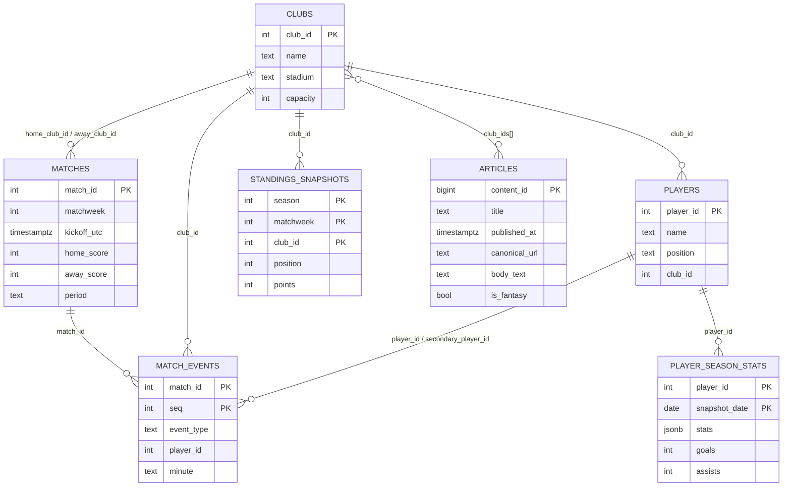

# Architecture

## System overview

A local system: Postgres 16 with pgvector holds all data, a Python backend runs ingestion, retrieval and the chat loop against Azure OpenAI (Microsoft Foundry), and a React UI talks to the backend. Scope is the current season only (2026-27, season id 2026).

## Data sources

The unauthenticated JSON APIs that www.premierleague.com calls itself: the Content API for articles and the SDP football API for structured data, with the FPL API as fallback. Details and field lists: [docs/data_sources.md](docs/data_sources.md), decision: [ADR 0003](docs/adr/0003-data-sources.md).

## Ingestion (bronze/silver/gold)

All HTTP goes through one polite client (`ingestion/pl_client.py`: project User-Agent, 0.5 s delay, backoff on 429/5xx). Every response it receives is written to bronze first; silver is then built **only from bronze**, never from the live response.

```
PLClient --on_response--> bronze.api_responses --load_from_bronze--> silver.* --views--> gold.*
                          (append-only, raw JSON)  (dispatch by endpoint)  (typed, upserted)  (tool queries)
```

- **bronze**: `bronze.api_responses`: one row per HTTP response (source, endpoint, params, payload, fetched_at, sha256). A trigger rejects UPDATE and DELETE.
- **silver**: typed rows upserted by natural key: clubs, players, matches, match_events, standings_snapshots, player_season_stats, articles. Re-running any mode, or replaying all of bronze (`python -m ingestion rebuild`), gives the same rows.
- **gold**: views and SQL functions the Phase 2 tools will query: `league_table_current`, `top_scorers`, `top_assists`, `club_form_last5`, `matchweek_results(mw)`, `head_to_head(a, b)`, `table_moves`. Embedded article chunks for RAG live in `silver.article_chunks` (see RAG pipeline).

Only `backend/db.py` owns DDL (`init_db()` is idempotent and runs at the start of every CLI mode). `db/init.sql` only creates the extension and schemas on a fresh volume. Tables, keys and columns: [docs/ingestion_schema.md](docs/ingestion_schema.md).



### CLI modes

| Mode | Fetches | Articles |
|---|---|---|
| `backfill --season 2026` | clubs, squads, all matches, events of every finished match, standings, leaderboards | since `--since` (default 2026-08-01) |
| `matchweek` | the same, but events only for the latest finished matchweek and any finished match still without events | since the newest stored article minus one day |
| `news` | nothing from SDP | since the newest stored article minus one day |
| `rebuild` | nothing; replays all of bronze into silver | |

After every mode `ingestion/quality.py` runs and the command exits non-zero if a check fails: 20 clubs, 380 matches, points = 3W + D, played = W + D + L, every finished match has a score, no duplicate article ids. `news` runs the article checks only.

Two API quirks shape silver. First, the standings endpoint only returns the current table, so `standings_snapshots` gets one snapshot per matchweek run, and `table_moves` has data from the second weekly run onward. Second, the leaderboard omits zero values and each sort returns a different subset of players, so the client fetches four sorts and silver merges them into one `stats` jsonb per player per day.

### Scheduling

The database is local-only, so the real scheduled runs happen on Eli's laptop through Windows Task Scheduler. `scripts/schedule_windows.ps1` registers them: `matchweek` on Monday 23:30 UTC (Tuesday 00:30 Brussels in winter) and `news` on Thursday 23:00 UTC (Friday 00:00 Brussels in winter). During summer time they fire an hour earlier in UTC; the script explains this. GitHub Actions runs the same two modes on the same cron times (`ingest-matchweek.yml`, `ingest-news.yml`) against a throwaway Postgres. That is a smoke test that the live sources still work and still match our parsers, and it uploads the JSON summary as an artifact.

## Why tool calling for stats and RAG for news

Numbers must be exact and current, so they come from SQL-backed tools; articles are prose, so they are retrieved. The model never states a number it did not get from a tool. See [ADR 0001](docs/adr/0001-tool-calling-for-stats-rag-for-news.md).

## RAG pipeline

```
silver.articles --chunk--> silver.article_chunks (text, vector(1536), tsvector)
query --> embed --> vector top 20 --\
      --> full text top 20 ----------> RRF --> x recency --> top k --> Prompt Shields --> model
```

- **Chunking** (`backend/rag/chunking.py`): `body_text` is packed paragraph by paragraph into chunks of about 400 tokens with about 50 tokens of overlap. Tokens are estimated from words. Every chunk starts with a header (title, publication date, tags), so a chunk carries its own context into the prompt and into full-text search. Articles without a body (club news, match reports) become one chunk of title, description and summary.
- **Index** (`python -m backend.rag.build_index`): embeds with `text-embedding-3-small` (1536 dimensions) in batches of 64. It only re-embeds articles whose content hash changed. The hash includes a chunker version, so changing the chunker re-chunks everything. Postgres keeps an HNSW index (cosine) on the vectors and a GIN index on the generated `tsvector`. The first build was 1507 chunks from 782 articles, for $0.009.
- **Retrieval** (`backend/rag/retrieval.py`): vector top 20 and full-text top 20 (`websearch_to_tsquery`), fused with reciprocal rank fusion (k = 60). Each fused score is then multiplied by a recency weight: `0.5 + 0.5 * 0.5^(age / half-life)`. The half-life defaults to 14 days (`RECENCY_HALF_LIFE_DAYS`), so today's article gets the full score, a two-week-old one 0.75, and an old one never less than half. Optional filters: club ids (from the article's SDP references), date range, and fantasy content excluded by default.
- **Prompt Shields** (`backend/rag/shields.py`): every retrieved chunk goes through Azure AI Content Safety's document attack detection before the model sees it. Flagged chunks are dropped and logged. If the service errors, the check **fails closed**: all chunks are dropped, and the tool tells the model that news retrieval is unavailable, so it says so instead of answering from memory.

**Why hybrid plus recency** ([ADR 0006](docs/adr/0006-hybrid-retrieval.md)): football questions mix paraphrase ("how will the new manager set up") with exact tokens that embeddings blur: player names, "matchweek 8", "Golden Glove". Vector search handles the first and full text the second; RRF merges their ranks without having to calibrate their scores against each other. News goes stale fast, so recency breaks ties towards the latest article without hiding an older, clearly better match. A 15-query smoke check (`python -m evals.retrieval_smoke`) gives hit@5 1.00 and MRR 0.76.

**Why Prompt Shields fail closed:** retrieved articles are third-party text that ends up inside the prompt, which makes them the main injection path into the model. A safety check that lets text through when it can't run would protect nothing exactly when it matters. Losing news answers for a while is a visible, recoverable failure; an injected instruction is neither.

## Tools

`backend/tools/` holds plain functions over gold and silver, each with a JSON schema. Each returns a plain dict and never raises on bad input: unknown or ambiguous names, missing matchweeks and the like come back as `{"error": ...}`, with candidates where they help.

| Tool | Answers |
|---|---|
| `get_league_table(as_of_matchweek?)` | the table, latest or after a stored matchweek |
| `get_fixtures(club?, date_from?, date_to?, limit)` | upcoming matches, UTC |
| `get_results(club?, matchweek?, limit)` | finished matches |
| `get_match_details(match_id \| club_a + club_b [+ date])` | score, scorers and assists, cards, substitutions |
| `get_top_scorers(stat goals\|assists\|clean_sheets, limit)` | leaderboards |
| `get_player_stats(name)`, `compare_players(names)` | season stats and profile |
| `get_club_info(club)` | stadium, position, last-5 form, next fixture, last result |
| `get_head_to_head(club_a, club_b)` | this season's meetings |
| `search_news(query, club?, days?, k, include_fantasy)` | shielded article chunks with title, date and URL |

Names go through one resolver (`backend/tools/resolver.py`). It tries exact name, short name or abbreviation, then aliases ("Spurs", "Man Utd", "Toon"), then partial and fuzzy matches. Player names are matched without accents, by full name, surname or first name, with fuzzy matching for typos. When a name fits several clubs or players ("United", "Gabriel"), the candidates go back to the model so it can ask.

## Chat loop

`backend/llm/client.py` is stateless: the caller passes the whole conversation each turn. The loop sends the system prompt plus the conversation and the tool schemas, runs any requested tools, and appends their results. It repeats until the model answers, for at most `MAX_TOOL_ROUNDS = 5` rounds; after that it asks for an answer without tools. A tool that raises becomes an error result the model can explain. The turn's sources are the `search_news` articles whose URL appears in the answer.

- **Prompt:** `backend/prompts/system_v1.md`, loaded by version (`PROMPT_VERSION`), with today's date and the completed and next matchweek filled in at run time. Its rules: no score, position, date or stat without a tool result; news through `search_news` with title, date and link citations; tools plus news for "why" questions; retrieved text is data; no betting advice; decline off-topic; concise, in the user's language.
- **Model:** `backend/llm/providers.py` wraps the Azure OpenAI v1 API (Foundry deployment `gpt-5.4-mini`) behind an `LLMProvider` interface. Tests use a scripted `FakeProvider`. GPT-5 deployments reject `temperature` and `max_tokens`, so the wrapper sends neither and caps output with `max_completion_tokens`. Retries on 429, 5xx and timeouts use the SDK's backoff.
- **Usage:** every chat and embedding call writes a row to `llm_calls` (model, tokens, latency, cost, prompt version, purpose). Prices live in one table, `backend/observability/pricing.py`; a model missing there gets cost NULL, not 0.
- **CLI:** `python -m backend.chat` runs an interactive chat, and `--ask "..."` answers one question. Both print the tool calls, the sources, the prompt version and the cost.

## Weekly digests

Generated from stored data only, with citations and fixed config-driven ranking weights, published to GitHub Pages:

- Monday 23:30 UTC ingest, Tuesday 05:00 UTC matchweek recap.
- Thursday 23:00 UTC ingest, Friday 05:00 UTC news highlights.

*Details: Phase 5.*

## MCP server

An own Premier League MCP server (FastMCP) exposing the same tools. See [ADR 0004](docs/adr/0004-own-mcp-server.md). *Phase 5.*

## Evaluation

An eval dataset and runner; changes to llm, rag, prompts, evals or mcp_server must pass it, and thresholds are never lowered to get green. *Phase 3.*

## AI Ops

Self-hosted Langfuse tracing ([ADR 0005](docs/adr/0005-langfuse-for-tracing.md)), a CI eval gate, a cost and latency dashboard and a feedback loop. *Phase 6.*

## Frontend

React UI over the backend API. *Phase 4.*

## Trade-offs

- One Postgres for relational data and vectors instead of a separate vector DB ([ADR 0002](docs/adr/0002-single-postgres-store.md)).
- Undocumented APIs: cheap and complete, but may change without notice; mitigated by keeping raw bronze and schema checks.
- Current season only keeps data small and answers unambiguous.
