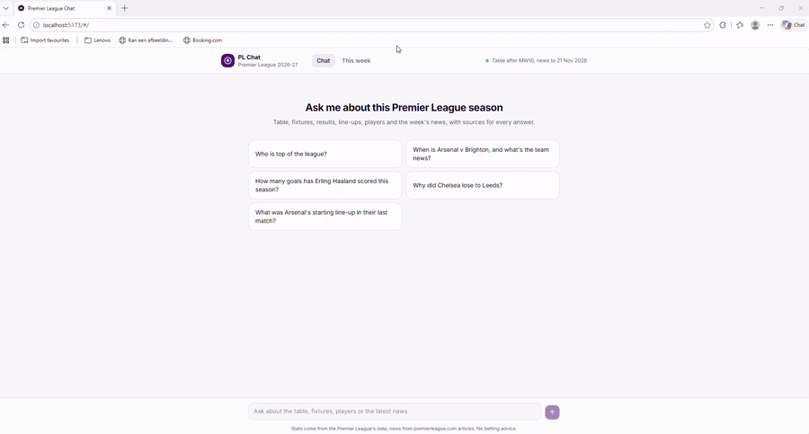
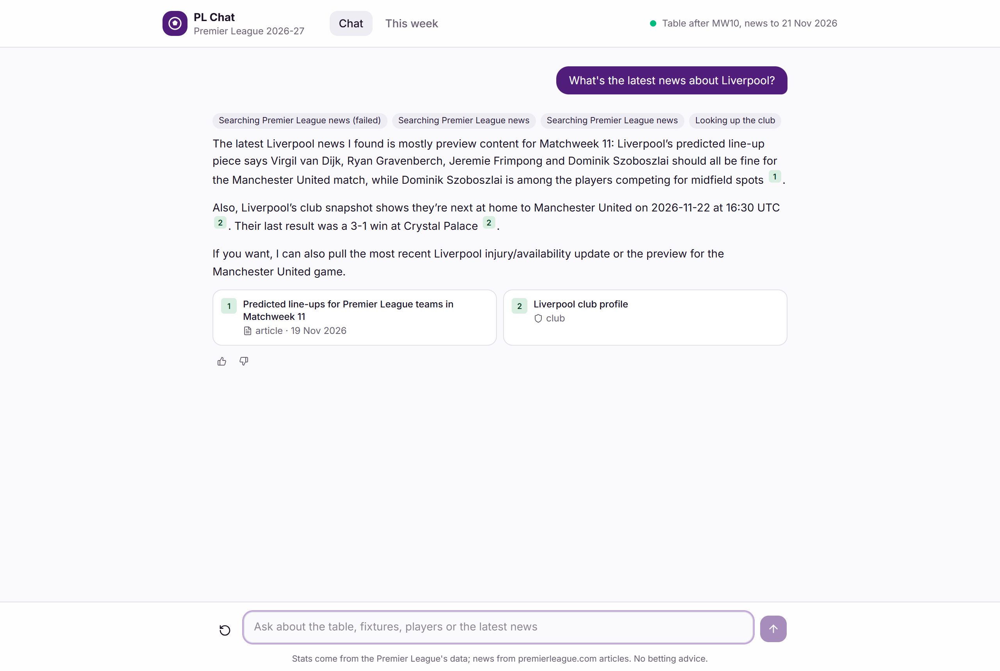
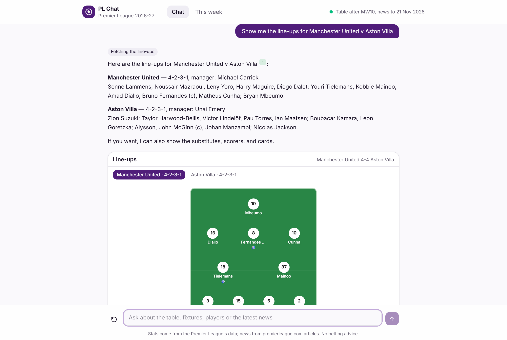
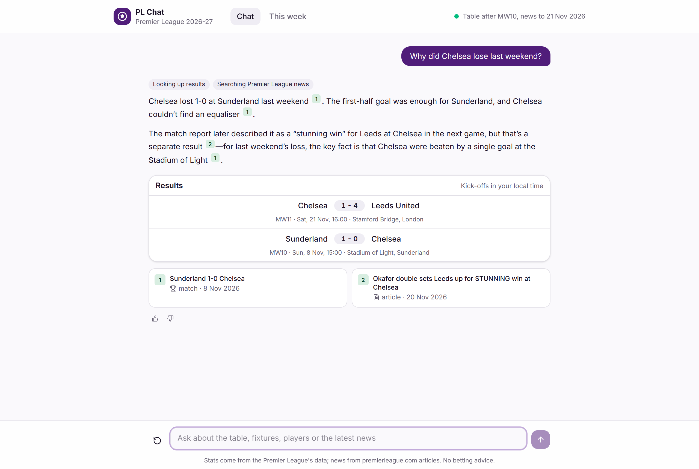

# Premier League chatbot

A chatbot about the current Premier League season (2026-27). Ask it about the table, results, fixtures, line-ups, players or the latest news. It answers from real data and shows where every fact came from.

- **Stats** (scores, positions, points, goals) come from tool calls on a database that is filled from the Premier League's own data feeds. The model never states a number it did not get from a tool.
- **News** comes from searching official premierleague.com articles (RAG). Every news answer cites the article's title, date and link.
- **Weekly summaries** are written automatically: a matchweek recap on Tuesday morning and news highlights on Friday morning.
- **Its tools are an MCP server**, so Claude Desktop, Claude Code and VS Code can use them too.

The chat app runs on your own computer only. What is public is the **[project website](https://elidehaene01.github.io/premier-league-chatbot/)**:
- the weekly summaries;
- a [showcase](https://elidehaene01.github.io/premier-league-chatbot/showcase.html) with a demo recording, screenshots and recorded conversations;
- the [AI Ops dashboard](https://elidehaene01.github.io/premier-league-chatbot/ops.html) with cost, speed, eval scores and data freshness.



| News with sources | Line-ups | "Why" questions |
|---|---|---|
|  |  |  |

How it fits together: [ARCHITECTURE.md](ARCHITECTURE.md). Every decision and why: [ARCHITECTURE.md, Decisions](ARCHITECTURE.md#decisions) and [docs/adr/](docs/adr/).

---

## Getting started

This guide assumes no programming experience. It is written for Windows. On a Mac or Linux the steps are the same, but type `python3` where it says `py`. Each step says what you should see, and the [troubleshooting](#when-something-goes-wrong) section covers the usual problems.

It takes about 30 minutes, most of it waiting for installs and the first data load.

### What it costs

The data is free. The language model and the safety check run on Microsoft Azure, which you pay for:
- One chat answer costs well under one cent.
- Loading the news into the search index costs about one cent.
- A full evaluation run costs about $0.90. You only run it when you choose to.

### Step 1: Install four programs

Install each one with its default options:

| Program | Where to get it | Why |
|---|---|---|
| **Git** | https://git-scm.com/downloads | downloads the code |
| **Python 3.12 or newer** | https://www.python.org/downloads/ (tick **"Add python.exe to PATH"** in the installer) | runs the chatbot |
| **Node.js** (the "LTS" version) | https://nodejs.org/ | runs the web page |
| **Docker Desktop** | https://www.docker.com/products/docker-desktop/ | runs the database |

After installing Docker Desktop, start it once and wait until it says **Engine running** at the bottom left. Restart your computer if the installer asks you to.

**Check:** open **PowerShell** (press the Windows key and type `PowerShell`) and type these one at a time:

```powershell
git --version
py --version
node --version
docker --version
```

Each one should print a version number. If one says "not recognized", install that program again, then close and reopen PowerShell.

### Step 2: Download the code

In PowerShell:

```powershell
cd ~\Documents
git clone https://github.com/EliDehaene01/premier-league-chatbot.git
cd premier-league-chatbot
```

**You should see** "Cloning into 'premier-league-chatbot'..." and then a new prompt. From now on, run every command from this `premier-league-chatbot` folder. If you open a new PowerShell window, first type `cd ~\Documents\premier-league-chatbot`.

### Step 3: Get the Azure keys

The chatbot needs two Azure services. If someone gave you the values below, skip this step.

1. **Azure OpenAI**, through [Microsoft Foundry](https://ai.azure.com/). Create a project, then deploy two models:
   - a chat model, for example `gpt-5.4-mini`;
   - the embedding model `text-embedding-3-small`.

   Note the endpoint (it looks like `https://<name>.openai.azure.com/openai/v1`), the API key and the two deployment names.
2. **Azure AI Content Safety**. Create the resource in the [Azure portal](https://portal.azure.com/); the free tier (F0) is enough. Note its endpoint and key. It checks every news article for hidden instructions before the model reads it.

### Step 4: Fill in your settings

```powershell
copy .env.example .env
notepad .env
```

Notepad opens the file `.env`. Fill in:
- `POSTGRES_PASSWORD`: make up any password. It only protects the database on your own computer.
- `AZURE_OPENAI_ENDPOINT`, `AZURE_OPENAI_API_KEY`, `AZURE_OPENAI_CHAT_DEPLOYMENT` and `AZURE_OPENAI_EMBEDDING_DEPLOYMENT`, from step 3.
- `CONTENT_SAFETY_ENDPOINT` and `CONTENT_SAFETY_API_KEY`, from step 3.

Leave everything else as it is. Save and close Notepad.

`.env` holds your keys. It is never uploaded to GitHub (the repository ignores it), so don't put keys anywhere else.

### Step 5: Start the database

```powershell
docker compose up -d
```

**You should see** "Container premier-league-chatbot-postgres-1 Started". The first time it also downloads the database image, which takes a minute. The database then starts by itself whenever Docker Desktop runs.

### Step 6: Install the chatbot

```powershell
py -m pip install -e ".[dev]"
```

**You should see** a lot of "Collecting..." lines and finally "Successfully installed ...". This takes a few minutes.

**Check:** `py -m pytest -m "not live" -q` runs the tests. It should end with a line like "110 passed" and no failures.

### Step 7: Load the season

```powershell
py -m ingestion backfill --season 2026
```

This downloads all clubs, players, matches, the table and the news articles so far. It takes about 3 minutes. **You should see** a summary that ends with a `"quality"` block in which every check says `"ok"`.

Then build the news search index (about one cent of Azure):

```powershell
py -m backend.rag.build_index
```

**You should see** something like `"articles_indexed": 797` and `"chunks_written": 1529`.

**Quick test in the terminal:**

```powershell
py -m backend.chat --ask "Who is top of the league?"
```

It prints the tools it used, an answer with `[1]`-style sources, and the cost of the answer.

### Step 8: Start the app

The app has two parts that each need their own PowerShell window.

**Window 1, the backend:**

```powershell
cd ~\Documents\premier-league-chatbot
py -m uvicorn backend.api.main:create_app --factory --port 8000
```

**You should see** "Uvicorn running on http://127.0.0.1:8000". Leave this window open.

**Window 2, the web page:**

```powershell
cd ~\Documents\premier-league-chatbot\frontend
npm ci
npm run dev
```

`npm ci` takes a minute the first time. **You should see** "Local: http://localhost:5173/". Leave this window open too.

### Step 9: Chat

Open **http://localhost:5173** in your browser.
- Click a suggested question, or type your own.
- The badge at the top shows whether the data is up to date.
- The **This week** page shows the latest weekly summaries.

To stop the app, press `Ctrl+C` in both windows. To start it again later, repeat step 8 only.

### Keeping the data up to date

Run these once a week, or let Windows do it for you (below):

```powershell
py -m ingestion matchweek    # new results, table and articles, and adds them to the search index
py -m ingestion news         # new articles only
```

To schedule them on Windows, run this once in PowerShell, with your `<python>` path (see [MCP](#use-the-tools-from-claude-or-vs-code-mcp) for how to find it):

```powershell
powershell -ExecutionPolicy Bypass -File scripts\schedule_windows.ps1 -Python "<python>"
```

It registers six tasks in Task Scheduler: the two data loads, the two weekly summaries (each one calls Azure and publishes the website) and two freshness checks. Docker Desktop must be running at those times.

### When something goes wrong

| What you see | What to do |
|---|---|
| `py` or `python` is "not recognized", or typing `python` opens the Microsoft Store | Reinstall Python from python.org with "Add python.exe to PATH" ticked, and use `py`. The Store's `python` is only a shortcut that opens the Store. |
| `docker compose up -d` says it cannot connect to the Docker daemon | Docker Desktop isn't running. Start it and wait for **Engine running**. |
| "port is already allocated" for 5433 | Something else uses that port. Pick another, for example `POSTGRES_PORT=5434` in `.env`, and run `docker compose up -d` again. |
| `password authentication failed` | You changed `POSTGRES_PASSWORD` after the database was first created. Put the old password back, or remove the database and start over with `docker compose down -v` and then `docker compose up -d`. This deletes the loaded data. |
| Windows blocks Python inside a `.venv` folder ("Smart App Control") | Install without a virtual environment, as in step 6. |
| The chat says news retrieval is unavailable | The Content Safety settings in `.env` are missing or wrong, or the free tier is briefly rate-limited. Check the two `CONTENT_SAFETY_*` values and try again a minute later. |
| `401` or `404` errors from Azure | An endpoint, key or deployment name in `.env` is wrong. The endpoint must end in `/openai/v1`, and the deployment names must match what you created in Foundry. |
| The web page loads but answers never come | Window 1 (the backend) isn't running, or it stopped with an error. Look there. |
| `npm` is "not recognized" | Install Node.js, then close and reopen PowerShell. |

---

## Use the tools from Claude or VS Code (MCP)

The chatbot's tools also run as an MCP server, so other AI apps can use the same data. [ARCHITECTURE.md, MCP](ARCHITECTURE.md#mcp-server) explains what MCP tools, resources and prompts are. You need steps 1 to 7 done first. Find the full path of your Python with `py -c "import sys; print(sys.executable)"`; the examples below call it `<python>`.

- **Claude Desktop:** open Settings > Developer > **Edit config**. Inside `"mcpServers"`, add:
  ```json
  "premier-league": { "command": "<python>", "args": ["-m", "mcp_server"] }
  ```
  Write the path with double backslashes (`C:\\Users\\...`). Quit Claude Desktop from the tray and reopen it; "premier-league" should show as **Running**. Name it in your question ("Use the premier-league tools: who is top?"), or Claude may use its own web search instead.
- **Claude Code:** `claude mcp add --scope local premier-league -- "<python>" -m mcp_server`. In PowerShell, type `claude.cmd` instead of `claude`.
- **VS Code:** the repository's `.vscode/mcp.json` starts the server with `python`. On Windows, change `"command"` to your `<python>` path. Then start the server from the MCP view and ask in Copilot Chat (agent mode).

Recorded demos of all three: [docs/showcase/](docs/showcase/).

---

## Command reference

For developers. Every command runs from the repository folder; `py` on Windows, `python` elsewhere.

```bash
# data
python -m ingestion backfill --season 2026   # first load
python -m ingestion matchweek                # weekly: latest matchweek + new articles (+ index)
python -m ingestion news                     # new articles (+ index)
python -m ingestion rebuild                  # rebuild silver from bronze, no network
python -m backend.rag.build_index            # embed new or changed articles

# chat
python -m backend.chat                       # interactive terminal chat
uvicorn backend.api.main:create_app --factory --port 8000
cd frontend && npm ci && npm run dev         # http://localhost:5173

# weekly summaries and the website
python -m digests recap | news               # write a summary (one Azure call or a few)
python -m digests publish --out preview      # render the site into a folder
python -m digests publish --push             # publish to the gh-pages branch

# MCP server
python -m mcp_server                         # stdio, for Claude Desktop / VS Code
python -m mcp_server --http                  # http://127.0.0.1:8765/mcp

# quality
ruff check . && pytest -m "not live"         # lint + tests (no Azure)
cd frontend && npm run lint && npm test
python -m evals.retrieval_smoke              # search quality, fractions of a cent
python -m evals.run --dataset chat_v1        # full eval, 165 cases, about $0.90
python -m evals.run --subset smoke           # 25 cases, about $0.15
python -m evals.digests                      # summary evals

# AI Ops
python scripts/langfuse_env.py               # once: Langfuse secrets into .env
docker compose -f docker-compose.langfuse.yml up -d   # tracing UI on http://localhost:3000
python -m backend.observability.freshness    # is the data up to date?
python -m evals.feedback review              # thumbs-down answers to look at
```

Evals need `pip install -e ".[eval]"` and exit non-zero below `evals/thresholds.yaml`. Latest full results: [docs/EVAL_RESULTS.md](docs/EVAL_RESULTS.md). The **Eval gate** workflow on GitHub runs the full set on every pull request that changes how the chatbot answers (about $0.90 a run). It skips draft pull requests, so work as a draft and mark it ready for review to run it once. It can also be started by hand (Actions > Eval gate > Run workflow).

## Project status

| Phase | What | Status |
|---|---|---|
| 0 | Setup and data source spike | done |
| 1 | Ingestion: bronze / silver / gold | done |
| 2 | RAG + tools + chat loop | done |
| 3 | Evals dataset | done |
| 4 | API + React UI + structured citations | done |
| 5 | Weekly summaries (GitHub Pages) + own MCP server | done |
| 6 | AI Ops: tracing, eval gate, dashboard, feedback loop | done |
| 7 | Clean-up and documentation | done |

The data comes from the public JSON feeds that premierleague.com itself uses ([docs/data_sources.md](docs/data_sources.md)). This is a personal, non-commercial project, not affiliated with the Premier League. Code: [MIT license](LICENSE).
